<div align="center">

# Udyam Digital

**From one sentence to a live business connection, in the owner's own language.**


**Team Ticchi Gang · NSUT Delhi**
YTL Hackathon 2026 · Enterprise Track A · Accel Business case

<a href="https://drive.google.com/file/d/18CISr8iT5qkPrn2CSHBP9XwBaVJNuqpK/view?usp=sharing">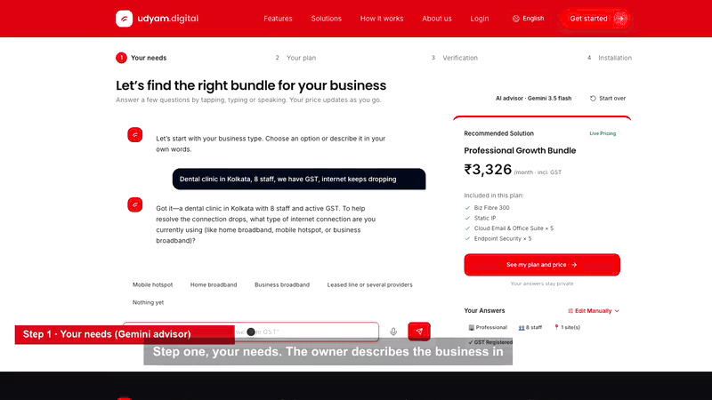</a>

**[▶ Watch the full 3-minute demo with voice-over](https://drive.google.com/file/d/18CISr8iT5qkPrn2CSHBP9XwBaVJNuqpK/view?usp=sharing)**

</div>

---

## Submission

| Deliverable | File |
|---|---|
| Demo video (2:59) | [Watch on Google Drive](https://drive.google.com/file/d/18CISr8iT5qkPrn2CSHBP9XwBaVJNuqpK/view?usp=sharing) · [Download MP4](submission/video/udyam-digital-demo.mp4) · [captions](submission/video/udyam-digital-demo.srt) |
| Solution architecture | [PNG](submission/architecture/Udyam_Digital_Architecture.png) · [PDF](submission/architecture/Udyam_Digital_Architecture.pdf) · [PPTX](submission/architecture/Udyam_Digital_Architecture.pptx) |
| Submission deck (7 slides, all deliverables) | [PDF](submission/deck/Udyam_Digital_Submission_7_Slides.pdf) · [PPTX](submission/deck/Udyam_Digital_Submission_7_Slides.pptx) |
| Business case (10 slides) | [PDF](submission/deck/Udyam_Digital_Business_Case.pdf) · [PPTX](submission/deck/Udyam_Digital_Business_Case.pptx) |
| Data privacy and security note (1 page) | [PDF](submission/privacy/Udyam_Digital_Privacy_Note.pdf) |
| Working prototype | This repository ([run it locally](#run-it-locally)) |

---

## The problem

Accel Business sells connectivity and digital services to small businesses. Today, getting one connected is slow and expensive:

- **7.4%** of leads become active customers.
- **17.6 days** from lead to a live connection.
- **3 status calls** per customer while they wait.
- **₹15,053** acquisition cost per activation; a quote alone takes 3 to 5 days.

Most of the delay is paperwork, KYC checks done by hand, and nobody telling the owner what happens next.

## Our solution

Udyam Digital lets an owner describe the business in plain words, get one clear monthly price, verify the business once, sign, pay and book the installation in a single sitting, on a phone or on WhatsApp. Staff only see the cases that need a person.

```
Advisor  →  Quote  →  Sign-in  →  KYC (DigiLocker, or PAN + documents)  →  e-Sign  →  UPI  →  Install slot  →  Live
```

- **Quote in about 3 minutes** instead of 3 to 5 days.
- **KYC in about a minute** with DigiLocker. No DigiLocker? Business PAN, a ₹1 bank check and documents read on our server.
- **No status calls**: an 11-step live tracker, with every update also sent on WhatsApp.
- **10 Indian languages**, by typing, tapping or speaking.

---

## Screenshots

<table>
  <tr>
    <td align="center" width="33%">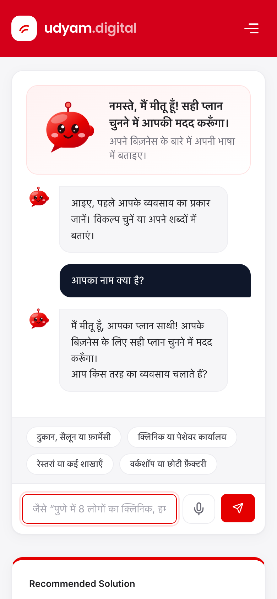<br><sub><b>Advisor</b> · the owner describes the business in Hindi</sub></td>
    <td align="center" width="33%">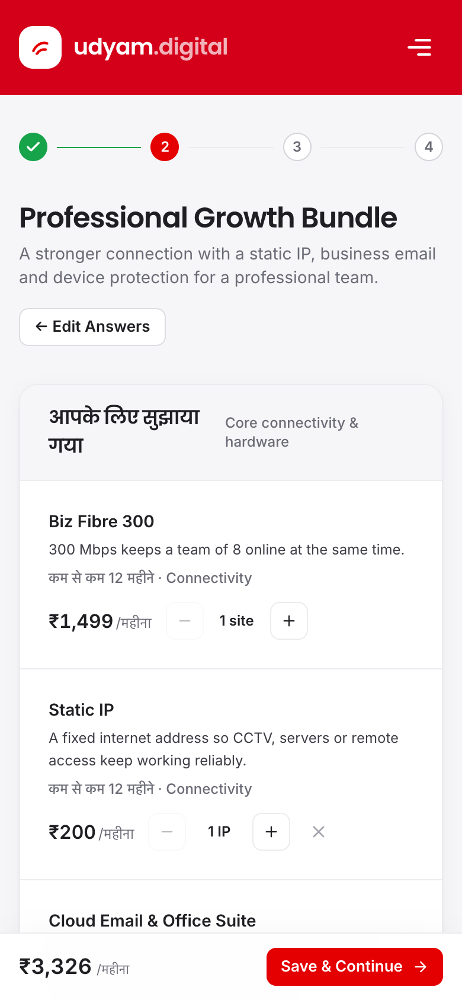<br><sub><b>Quote</b> · eligible products, one monthly price with GST</sub></td>
    <td align="center" width="33%">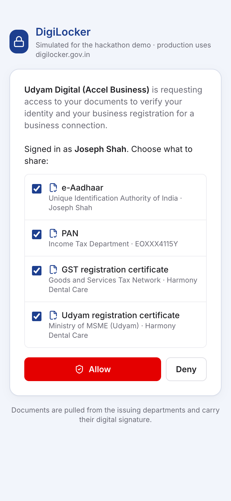<br><sub><b>DigiLocker</b> · signed documents from the issuers</sub></td>
  </tr>
  <tr>
    <td align="center">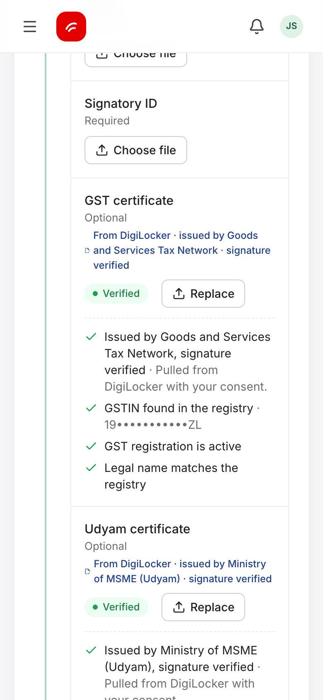<br><sub><b>Verified</b> · registry and signature checks pass</sub></td>
    <td align="center">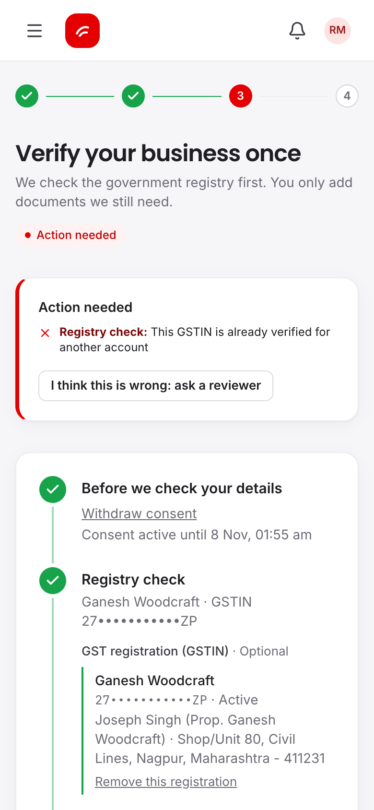<br><sub><b>Hard stop</b> · a GSTIN already verified by another owner</sub></td>
    <td align="center">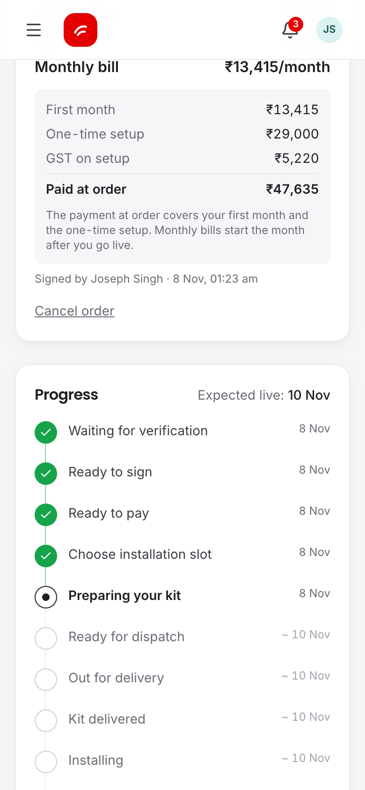<br><sub><b>Tracker</b> · every step with dates, no calls needed</sub></td>
  </tr>
  <tr>
    <td align="center">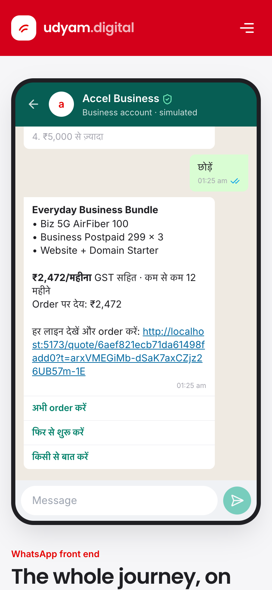<br><sub><b>WhatsApp</b> · the same journey by chat</sub></td>
    <td align="center">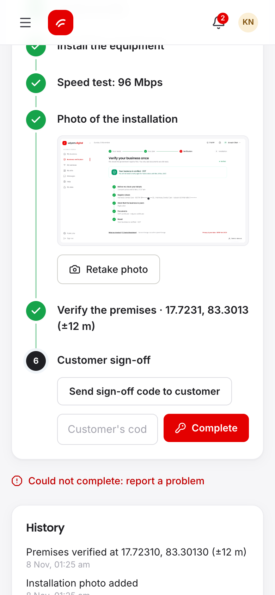<br><sub><b>Technician</b> · GPS check-in and owner sign-off</sub></td>
    <td align="center"></td>
  </tr>
</table>

<table>
  <tr>
    <td align="center" width="33%">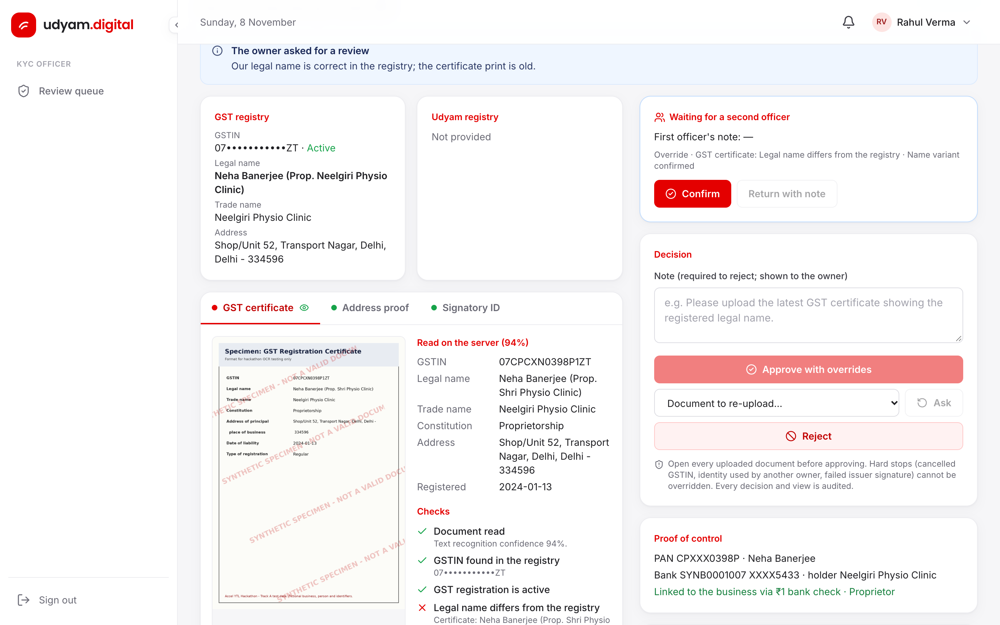<br><sub><b>KYC officer</b> · side by side, second officer confirms</sub></td>
    <td align="center" width="33%">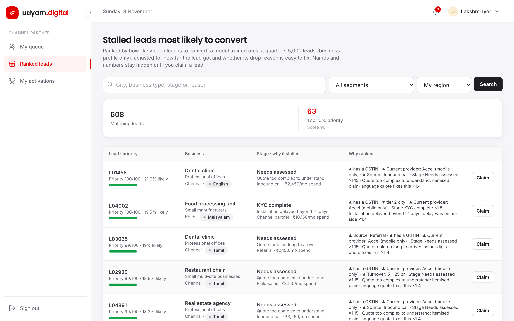<br><sub><b>Partner</b> · stalled leads ranked by likelihood to convert</sub></td>
    <td align="center" width="33%">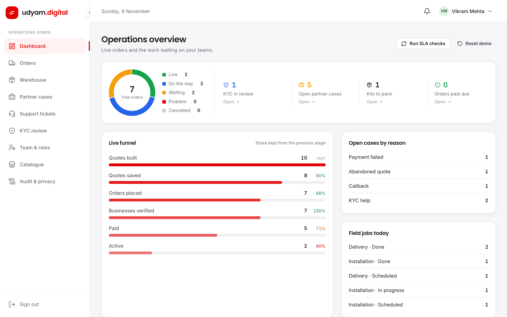<br><sub><b>Operations</b> · live funnel against the case baseline</sub></td>
  </tr>
</table>

---

## Architecture

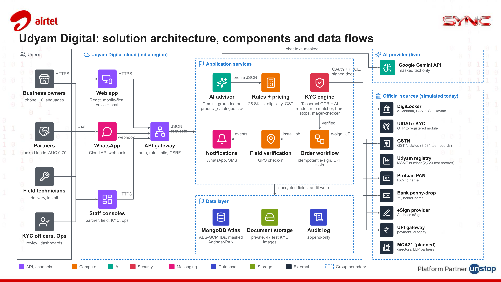

- **Channels.** A mobile-first React web app with voice and chat, a WhatsApp Cloud API webhook, and staff consoles, all behind one API gateway (auth, rate limits, CSRF checks).
- **AI advisor.** Gemini reads the owner's words and fills a structured profile. It is grounded on `product_catalogue.csv` and can only name real products. The rules engine, not the AI, picks every product and sets every price.
- **KYC engine.** DigiLocker (OAuth 2.0 with PKCE, issuer signatures checked) as the fast path. Fallback: business PAN, ₹1 bank check, and documents read twice on our server (Tesseract OCR and a second AI reader), matched against the GSTIN and Udyam registries by rules.
- **Orders and field.** Idempotent e-sign and UPI, installation slots, technician GPS check-in, and notifications in the owner's language.
- **Data and privacy.** MongoDB Atlas with GSTIN, Udyam and Aadhaar references encrypted (AES-256-GCM) and looked up by keyed hash; PAN and Aadhaar masked on every screen; private document storage; append-only audit log.

Official sources (DigiLocker, UIDAI, GSTN, Udyam, PAN, bank, eSign, UPI) are simulated in the prototype behind the same interfaces a licensed provider would use.

---

## What each role sees

| Role | What they do |
|---|---|
| **Business owner** | Advisor → quote → sign-in → verify once → e-sign → pay → book a slot → follow the tracker. |
| **Owner on WhatsApp** | The same advisor by chat in 10 languages, an order link, and "track my order". |
| **Channel partner** | Cases the journey could not close, and stalled leads ranked by likelihood to convert, with reasons. |
| **KYC officer** | Only applications that failed a check, shown side by side with the registry. Every override needs a reason. |
| **Second officer** | Confirms or returns every override (maker-checker). |
| **Technician** | Install checklist, speed test, photo, GPS check-in at the premises, and the owner's sign-off code. |
| **Operations** | Live funnel against the 5,000-lead baseline, orders, warehouse, tickets, audit log, data requests. |

---

## How we keep KYC trustworthy

1. **Signed documents from the source.** With DigiLocker, e-Aadhaar, PAN, GST and Udyam certificates come from the issuing departments and their signatures are checked.
2. **Proof of control, not just existence.** A GSTIN is public. The owner also proves control: the registration in their own DigiLocker, or the business PAN plus a ₹1 deposit that returns the account holder's name.
3. **Documents read on our server.** Uploads are read by OCR and a second AI reader, then matched to the registry. A tampered certificate fails its GSTIN checksum.
4. **Hard stops nobody can override.** Cancelled or suspended GSTIN, or a GSTIN, Udyam, Aadhaar or bank account already verified by another owner.
5. **Maker-checker and site check.** An officer must open every document and give a reason for each override, a second officer confirms, and the line goes live only after the technician's GPS check-in and the owner's sign-off code.

---

## Results against the case baseline

| Measure | Case baseline | In our prototype | Pilot target |
|---|---|---|---|
| Time to a quote | 3–5 days | about 3 minutes | — |
| KYC | manual checks | about 1 minute with DigiLocker, 17 automatic checks | — |
| Lead to activation | 7.4% | — | 12% |
| Days to activate | 17.6 | — | 7 or fewer |
| Status calls per customer | 3 | live tracker + WhatsApp updates | below 0.5 |
| Cost per activation | ₹15,053 | — | below ₹9,000 |
| Lead ranking model | — | AUC 0.70 on held-out leads, 2× activation rate in the top 10% | — |

Targets are for a pilot in two tier-1 cities; the business case explains how they are measured.

---

## Run it locally

**You need:** Node 20 or newer (24 recommended) and MongoDB (a local `mongod` or a free Atlas cluster).

```bash
npm run install:all
```

```bash
cp backend/.env.example backend/.env
```

Set `MONGO_URI` in `backend/.env`. Add `GEMINI_API_KEY` for the AI advisor and the second document reader; without it the advisor uses its local rules and documents are read by OCR only. Then, in two terminals:

```bash
npm run dev:api
```

```bash
npm run dev:web
```

Open http://localhost:5173. On first start the API loads the catalogue, the registries and the 5,000 leads, creates the demo staff, and seeds nine demo businesses at different stages.

### Try it in 5 minutes

1. On the home page, type *"Dental clinic in Kolkata, 8 staff, we have GST, internet keeps dropping"*.
2. Open the quote, sign in (the OTP is shown on screen), then **Verify** with DigiLocker, or use **Demo: load specimen applicant** for the upload path.
3. E-sign, pay by UPI and pick a slot.
4. Use **Demo: view as…** (bottom right) to see the same order as the warehouse, technician, partner, KYC officer and operations.
5. Open `/whatsapp` for the same journey by chat.

### Demo accounts

| Role | Sign in |
|---|---|
| Business owner | Any 10-digit mobile number starting with 6, 7, 8 or 9. The OTP is shown on screen in demo mode. |
| Operations | `vikram.ops@udyam.demo` at `/staff/login` |
| KYC officers | `priya.kyc@udyam.demo` (maker), `rahul.kyc@udyam.demo` (checker) |
| Channel partner | `lakshmi.partner@udyam.demo` |
| Technician | `karthik.tech@udyam.demo` |

Staff password: `Demo@12345` (set by `DEMO_STAFF_PASSWORD`). Or skip passwords with **Demo: view as…**.

- **DigiLocker demo:** pick a demo resident such as *K02 · Joseph Shah*; the OTP is shown on screen.
- **Aadhaar e-KYC demo:** any valid test number such as `499112345677`.
- **Reset the demo data:** Operations → Dashboard → **Reset demo**, or `npm run reset`.

### Tests

```bash
npm test
```

78 tests: the advisor scenario bank and a sweep of 2,000 profiles, real OCR over all 47 specimen images, one end-to-end journey across every role (including access control and DPDP erasure), the no-registration path, and the WhatsApp channel. They need MongoDB on `127.0.0.1:27017` and use their own throwaway database.

<details>
<summary><b>Configuration and deployment</b></summary>

All settings live in `backend/.env` (see `backend/.env.example`). The frontend needs no secrets. With `NODE_ENV=production` the server refuses to start until the security values are set.

| Variable | Needed for |
|---|---|
| `MONGO_URI` | Always. Local `mongodb://127.0.0.1:27017/udyam_digital` or an Atlas connection string |
| `JWT_SECRET`, `DATA_ENCRYPTION_KEY` | Production. Generate each with `node -e "console.log(require('crypto').randomBytes(48).toString('base64url'))"`. Never change the encryption key on a live database |
| `GEMINI_API_KEY`, `GEMINI_MODEL`, `GEMINI_FALLBACK_MODEL` | AI advisor and second document reader (Google AI Studio). Falls back to the lighter model, then local rules |
| `ANTHROPIC_API_KEY`, `ADVISOR_AI` | Optional alternative advisor, used only when no Gemini key is set |
| `R2_ACCOUNT_ID`, `R2_ACCESS_KEY_ID`, `R2_SECRET_ACCESS_KEY`, `R2_BUCKET` | Private document storage on Cloudflare R2. Empty = `backend/uploads` |
| `WHATSAPP_TOKEN`, `WHATSAPP_PHONE_NUMBER_ID`, `WHATSAPP_VERIFY_TOKEN`, `WHATSAPP_APP_SECRET` | Real WhatsApp Cloud API. Without them, the `/whatsapp` simulator |
| `CLIENT_URL` | Production site URL |
| `DEMO_MODE`, `OTP_DEV_MODE` | `true` for the demo. Set both to `false` for real users |
| `KYC_REFERENCE_DATE` | `2026-07-15`, the date the specimen documents are checked against |

Check live keys with `npm run check:live` from `backend/`.

**Deploy on one server:** set the variables above with `NODE_ENV=production` and `DEMO_MODE=false`, run `npm run install:all` then `npm start` (Express serves the built React app and the API on `PORT`), and put it behind HTTPS. More in [PRODUCTION.md](PRODUCTION.md).

</details>

---

## Tech stack

| Layer | Technology |
|---|---|
| Frontend | React 19, Vite, Tailwind CSS, 10 languages, Web Speech voice input |
| Backend | Node.js, Express 5, Mongoose |
| Database | MongoDB Atlas |
| AI | Google Gemini (advisor and second document reader), with local rules as fallback |
| Documents | Tesseract.js OCR, private storage on Cloudflare R2 or local disk |
| Channels | Web, WhatsApp Cloud API |

```
├── backend/      Express API: controllers, models, routes, services, libs, tests
├── frontend/     React app: screens for every role
├── submission/   video, architecture, business case, privacy note, screenshots
└── package.json  scripts for both apps
```

---

## Privacy

Consent is asked for one stated purpose before any check runs, and it expires after 30 minutes. Identifiers are encrypted at rest and masked on screen; text is masked before it reaches the AI; owners can request access to their data or its erasure. Full details are in the [privacy and security note](submission/privacy/Udyam_Digital_Privacy_Note.pdf).

All businesses, people and identifiers in this repository are synthetic, from the case pack.

---

## Team

**Team Ticchi Gang** · NSUT Delhi
Monis (Team Leader) · Ubesh Siddiqui
